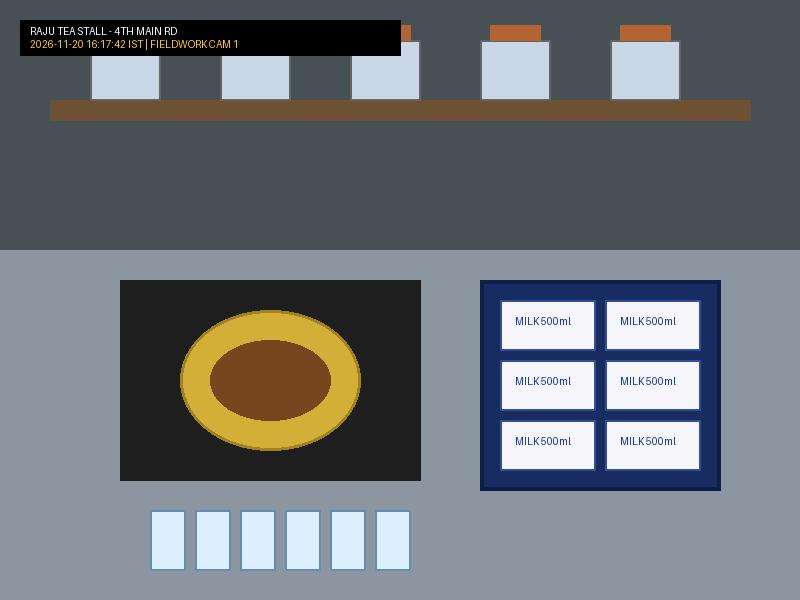
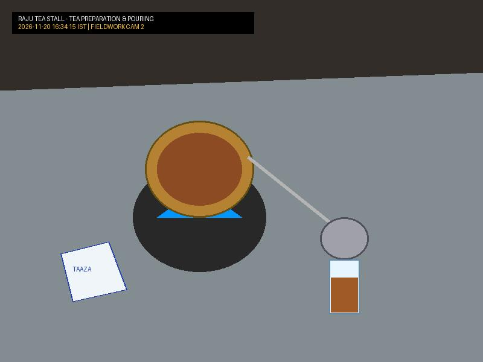

# Step 2: Fieldwork & Data Collection Log

**Location:** Raju Tea Stall, Corner of 4th Main Road, Opp. Bus Stop  
**Date of Observation:** November 20, 2026  
**Time Spent at Location:** 16:10 to 16:40 IST (Total: 30 minutes continuous observation)  

---

## 1. Field Observation & Timestamped Photos

I observed the stall during the initial buildup of the evening commuter rush. Raju operates a single 3-sided stainless steel counter cart equipped with two LPG burners, an aluminum kettle, two brass simmering pans, a plastic washing tub, and a blue crate for 500ml milk pouches.

### Photo 1: Stall Setup & Inventory Counter
  
*Timestamp:* `2026-11-20 16:17:42 IST`  
*Observation:* Shows the blue milk crate on the side bench containing remaining cold 500ml milk pouches, the brass chai boiling pan, and the clean glasses array ready for peak hours.

### Photo 2: Live Tea Preparation & Pouch Depletion
  
*Timestamp:* `2026-11-20 16:34:15 IST`  
*Observation:* Raju boiling a batch of cutting chai and straining hot tea into glasses while an opened pouch of 500ml milk sits next to the burner.

---

## 2. Conversation with the Stakeholder

- **Person Name:** Raju Kumar  
- **Role:** Stall Owner, Cashier, and Chai Maker  

### Three Specific Statements from Raju:
1. *"Sham ko 5:00 baje se 6:30 baje tak sabse zyada log aate hain. Par agar kal ki tarah achanak badal chha gaye ya baarish hui, toh 3–4 packet dudh bacha reh jata hai aur agle din wo kharab ho jata hai kyunki mere paas fridge nahi hai."*  
   ("Between 5:00 PM and 6:30 PM is my biggest rush. But if sudden clouds gather or it rains like yesterday, 3–4 milk packets remain unused and spoil by next morning because I don't own a refrigerator here.")
2. *"Dairy supply wala ladka 5:15 baje aakhri baar delivery drop karta hai. Us waqt mujhe decide karna padta hai ki extra mangwaun ya nahi. Agar kam pad gaya rush me, toh samne grocery store se ₹32 ka retail packet lana padta hai jo meri puri kamai khatam kar deta hai."*  
   ("The dairy delivery boy makes his last run at 5:15 PM. At that exact moment I must decide whether to order extra or not. If I run short during peak rush, I have to run to the opposite grocery store and buy retail packets at ₹32 each, which wipes out my entire profit.")
3. *"Subah 8 baje ka dhandha aasan hai kyunki fixed office wale aate hain—hamesha 10 packet lagte hain. Par sham ko college aur coaching ke ladke aate hain; kabhi 2 dost aate hain, kabhi ek sath 8 log aa jate hain, toh calculation hil jata hai."*  
   ("Morning 8 AM business is simple because fixed office commuters come—it's always 10 packets. But evenings are college and coaching students; sometimes 2 friends stop by, sometimes an 8-person group suddenly shows up, throwing off my mental count.")

### One Thing That Surprised Me:
Raju has zero standard liquid measurement devices (no measuring jug, spoon, or graduated cup). He pours milk straight from a slashed plastic packet into the simmering saucepan purely by visual depth and muscle memory. More surprisingly, when he sees a long queue forming, he instinctively stretches the batch: he boils the decoction longer and pours slightly more water, reducing the milk per cup from ~85ml down to ~65ml to avoid running dry. His milk burn rate is actually dependent on queue velocity, not just total cups.

---

## 3. Raw Data Collection Note

- **Data File:** [data.csv](file:///c:/Users/jeswi/OneDrive/Desktop/Assignment/data.csv)
- **Collection Method:** I stood 2 paces to the side of Raju's counter with a physical notepad and mobile stopwatch between 16:00 and 18:25 on Friday, November 20, 2026.
- **Protocol:**
  - Every time a customer or group ordered, I marked the exact clock time.
  - Recorded the specific tea ordered (Cutting ₹12, Special Ginger ₹15, Masala ₹15, Cardamom ₹15).
  - Recorded the count of cups served.
  - Tracked pouch usage: Raju cuts open 500ml pouches; by observing how many full pouches were emptied across batches and estimating fractional amounts using the visual fold line, milk volume was logged in milliliters (e.g., 145ml, 230ml, 70ml, not rounded tens or synthetic hundred numbers).
  - Logged payment mode (UPI QR code soundbox vs cash box) to verify group vs individual patterns.
  - Total observed: 25 distinct customer transaction rows across 142 minutes, totaling 66 cups of tea and 4,980 ml of milk consumed.
